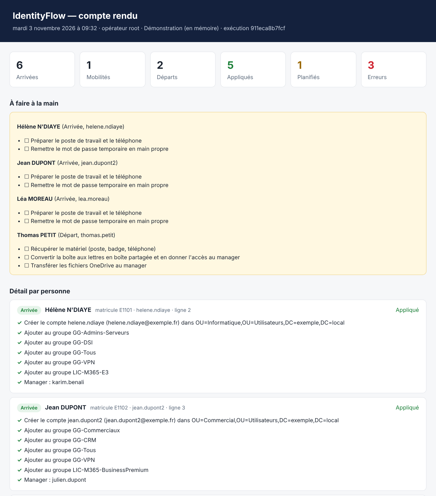

# IdentityFlow

**Arrivées, mobilités et départs des collaborateurs, automatisés à partir de l'export RH.** IdentityFlow lit le fichier que produit le service RH, calcule ce qui doit changer dans l'annuaire (Active Directory ou Entra ID) selon des règles par service, par poste et par contrat, montre le plan, l'applique, journalise chaque action et remet un compte rendu lisible par un non-informaticien.

Module PowerShell, compatible Windows PowerShell 5.1 et PowerShell 7.



## Le problème

Dans beaucoup de PME et d'ETI, les mouvements de personnel passent par des mails et des tickets : « Léa arrive lundi au service RH ». Le technicien crée le compte à la main, en copiant les groupes d'un collègue. Résultat :
- des droits hérités par erreur ;
- des comptes de stagiaires encore actifs six mois après leur départ ;
- des licences Microsoft 365 payées pour des personnes parties ;
- et, le jour de l'audit, aucune trace de qui a fait quoi.

IdentityFlow remplace ce processus par une règle écrite une fois et appliquée à chaque mouvement, identique pour tout le monde.

## Ce que fait IdentityFlow

| Mouvement | Actions |
|---|---|
| **Arrivée** | Identifiant unique (`prenom.nom`, sans accent, `jean.dupont2` si homonyme), compte dans l'OU du service, groupes communs + service + poste + contrat, licence Microsoft 365 par groupe, manager, expiration automatique pour les CDD, alternances et stages, mot de passe temporaire à changer à la première connexion. Compte créé une semaine avant l'arrivée. **Réembauche** détectée : le compte existant est réactivé au lieu d'en créer un second. |
| **Mobilité** | Nouveaux service, poste, site ou manager ; déplacement d'OU ; groupes ajoutés et retirés. Seuls les groupes gérés (`GG-*`, `LIC-*`) sont retirés : un accès accordé à la main n'est jamais supprimé en silence. |
| **Départ** | Le lendemain du dernier jour : compte désactivé, mot de passe aléatoire, retrait de tous les groupes (donc des licences), déplacement vers l'OU des départs, mention datée, masquage de la liste d'adresses, révocation des sessions (Entra ID), liste des actions manuelles (matériel, boîte aux lettres, OneDrive). |
| **Purge** | Suppression définitive après 90 jours, uniquement pour les comptes désactivés portant la mention de départ d'IdentityFlow. |
| **Annulation** | Un départ appliqué par erreur se défait en une commande, à partir du journal : groupes, OU, description et visibilité restaurés. |

## Les garde-fous

- **Plan avant action** : `Get-IFPlan` ne modifie rien. `-WhatIf` montre chaque étape. `-Confirm` demande une validation une par une.
- **Idempotence** : l'état voulu est comparé à l'état réel. Relancer le même fichier ne refait rien, et une exécution quotidienne planifiée est donc sans risque.
- **Erreurs isolées** : une ligne invalide (service inconnu, CDD sans date de fin, matricule introuvable) est rejetée avec sa raison, sans bloquer le reste du lot. Une étape en échec n'arrête que la personne concernée.
- **Journal d'audit JSONL** : une ligne par étape, avec qui, quand, sur quel compte, l'ancienne et la nouvelle valeur, et le résultat. Il s'exploite tel quel dans un SIEM.
- **Aucun mot de passe** dans le journal ni dans le compte rendu. Les mots de passe temporaires sont renvoyés en `SecureString`, et peuvent être exportés chiffrés par DPAPI pour la remise.
- **Purge prudente** : un compte réactivé, ou déplacé à la main dans l'OU des départs, n'est jamais supprimé.

## Essayer sans Active Directory

```powershell
git clone https://github.com/SunoriOff/identityflow; cd identityflow
pwsh ./examples/demo.ps1
```

La démo utilise un annuaire fictif en mémoire ([`examples/annuaire-demo.json`](examples/annuaire-demo.json)) et l'export RH d'exemple ([`examples/export-rh.csv`](examples/export-rh.csv)). Elle enchaîne une simulation, l'application, une relance (rien à refaire), l'annulation d'un départ et une purge simulée. Le compte rendu HTML est écrit dans le dossier temporaire.

## Utilisation

### 1. L'export RH

Un CSV séparé par des points-virgules, tel qu'Excel l'enregistre. La casse et les accents des en-têtes n'ont pas d'importance.

```csv
Action;Matricule;Prénom;Nom;Poste;Service;Site;Manager;Contrat;DateEffet;DateFin
Arrivée;E1103;Léa;Moreau;Assistante RH;Ressources humaines;Nantes;E1020;Alternance;2026-11-02;2028-08-31
Mobilité;E1031;;;Comptable;Comptabilité;;E1001;;2026-11-01;
Départ;E1045;;;;;;;;2026-10-31;
```

Pour un départ, `DateEffet` est le dernier jour travaillé. Les dates sont acceptées au format `AAAA-MM-JJ` ou `JJ/MM/AAAA`.

### 2. Les règles

Un fichier [`regles.psd1`](examples/regles.psd1) décrit l'organisation :
- les OU, le suffixe UPN et le format des identifiants ;
- par service : l'OU, les groupes et la licence ;
- par poste : des droits supplémentaires ;
- par contrat : les groupes, la licence et l'obligation d'une date de fin ;
- au départ : les actions manuelles à lister.

### 3. L'exécution

```powershell
Import-Module ./src/IdentityFlow

# Active Directory (licences Microsoft 365 par groupes synchronisés)
$ad = New-IFADProvider -Server dc01.exemple.local -ExchangeAttributes

# Toujours simuler d'abord
Start-IFRun -RequestPath .\export-rh.csv -RulesPath .\regles.psd1 -Provider $ad -WhatIf

# Puis appliquer
$r = Start-IFRun -RequestPath .\export-rh.csv -RulesPath .\regles.psd1 -Provider $ad `
        -AuditFolder D:\IdentityFlow\audit -ReportFolder D:\IdentityFlow\rapports
$r | Format-Table Line, ActionLabel, Name, Login, State
```

Pas à pas, pour garder la main :

```powershell
$rules = Import-IFRules .\regles.psd1
$plan  = Import-IFRequest .\export-rh.csv | Get-IFPlan -Rules $rules -Provider $ad
$plan | Where-Object State -eq 'Invalid' | Format-List Line, EmployeeId, Errors
$plan | Invoke-IFPlan -Provider $ad -AuditPath .\audit\2026-11.jsonl -Confirm
```

Pour Entra ID, avec des comptes « cloud only » :

```powershell
Connect-MgGraph -Scopes User.ReadWrite.All, GroupMember.ReadWrite.All, User.RevokeSessions.All
$entra = New-IFGraphProvider -UsageLocation FR
```

### 4. Annuler, purger

```powershell
Undo-IFLeaver -EmployeeId E1045 -AuditPath D:\IdentityFlow\audit -Provider $ad
Invoke-IFPurge -Rules $rules -Provider $ad -WhatIf      # liste ce qui serait supprimé
```

### Tâche planifiée

Lancez `Start-IFRun` chaque matin avec un compte de service limité :
- droits délégués sur les OU gérées ;
- gestion des membres des groupes `GG-*` et `LIC-*` ;
- aucun droit d'administrateur du domaine.

Les comptes rendus sont datés, et le journal est découpé par mois.

## Architecture

```text
export RH (CSV) ─► Import-IFRequest ─► demandes validées ligne par ligne
règles (.psd1)  ─► Import-IFRules   ─► profil voulu par service / poste / contrat
                                          │
annuaire ◄──── connecteur ◄──── Get-IFPlan : état voulu − état réel = étapes
(AD, Entra ID,                            │
 démo en mémoire)                Invoke-IFPlan : ShouldProcess, exécution,
                                          │       erreurs isolées, journal JSONL
                                          ▼
                     New-IFReport (HTML) · Undo-IFLeaver · Invoke-IFPurge
```

Le moteur ne connaît pas l'annuaire : il parle à un **connecteur** qui expose une douzaine d'opérations (`FindByEmployeeId`, `NewUser`, `AddToGroup`, `MoveUser`…). Trois connecteurs sont fournis :
- **Active Directory** (module RSAT) ;
- **Entra ID** (Microsoft Graph PowerShell) ;
- **démonstration en mémoire**, qui sert aussi aux tests.

Ajouter un autre annuaire (un LDAP générique, par exemple) ne touche pas au moteur.

## Tests

```powershell
Invoke-Pester ./tests
```

52 tests Pester 5 couvrent :
- le nommage : accents, ligatures, homonymes, troncature ;
- les mots de passe : complexité, unicité ;
- la validation du CSV, ligne par ligne ;
- les arrivées, y compris un manager qui arrive dans le même lot et la réembauche ;
- les mobilités : groupes ajoutés à la main conservés, groupes de contrat préservés ;
- les départs, `-WhatIf`, l'idempotence et l'isolation des erreurs ;
- l'absence de mot de passe dans le journal, l'annulation, la purge et l'échappement HTML du rapport ;
- les connecteurs AD et Entra ID, dont les cmdlets sont simulées : bons paramètres, échappement des filtres, homonymes.

La CI exécute les tests sous Windows PowerShell 5.1, sous PowerShell 7 (Windows et Linux), puis l'analyse PSScriptAnalyzer.

## Limites

- Les licences sont attribuées par groupe, ce qui suppose les licences basées sur les groupes de Microsoft 365. C'est la pratique recommandée.
- Les actions sur la boîte aux lettres (conversion en boîte partagée, délégation) restent dans la liste manuelle : elles dépendent d'Exchange Online PowerShell et des choix de chaque entreprise.
- Avec Entra ID : il n'y a ni OU ni attribut d'expiration, et la purge n'est pas proposée, puisque les comptes supprimés restent 30 jours dans la corbeille.

## Licence

WTFPL — Joris Pelaud
